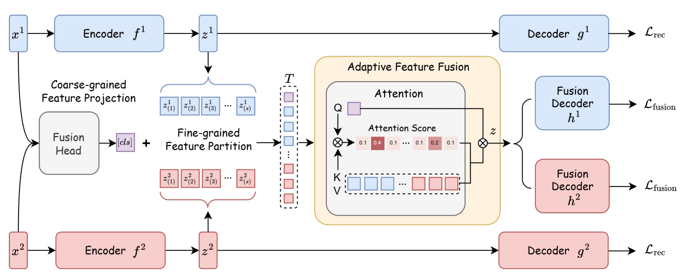

# scMAF: Single-Cell Multi-Omics Clustering via Adaptive Modality Fusion

This repository provides the official implementation of our paper:

> Jun Fu, Yiding Lu, Ruohong Yang, Yunfan Li, Xi Peng <br>
> *scMAF: Single-Cell Multi-Omics Clustering via Adaptive Modality Fusion*, NeurIPS 2026 (poster). 👉 [[Paper]](https://openreview.net/forum?id=HAcmGGgXow)


## Introduction

- Given that different modalities in single-cell multi-omics data exhibit **varying discriminative power across cell types**, this work investigates the challenge of effectively integrating complementary multi-omics information for accurate cell clustering.

- Unlike existing methods that rely on shallow fusion strategies, such as feature concatenation or fixed modality weighting, we propose **scMAF**, an adaptive modality fusion framework for single-cell multi-omics clustering. Specifically, scMAF learns modality-specific representations and employs an attention-based fusion module to dynamically aggregate informative signals from different modalities, emphasizing discriminative information while suppressing interference from less informative or noisy modalities.

- Extensive experiments on **eight real-world single-cell multi-omics datasets** demonstrate that scMAF achieves state-of-the-art clustering performance against **fourteen competitive baselines**.




## Installation

Python 3.10 or 3.11 is recommended. For the CUDA 11.8 environment used in our
experiments:

```bash
conda env create -f environment.yml
conda activate scmaf
pip install -e .
```

For an existing PyTorch environment:

```bash
pip install -e .
```

Use `environment.yml` for new installations.


## Configuration

The hyperparameters and training options for all datasets used in the paper are provided as YAML configuration files in the `/config` directory.


## Training

Multi-omics example:

```bash
python train.py --config config/multiomics/spector.yaml --device cuda:0
```

Multi-view examples:

```bash
python train.py --config config/multiview/nuswide.yaml --device cuda:0
python train.py --config config/multiview/xmedianet.yaml --device cuda:0
```

Command-line options override YAML values. For example:

```bash
python train.py --config config/multiomics/spector.yaml \
  --epochs 400 --batch-size 256 --lr 1e-3 --runs 5 --device auto
```

Use `--device auto` to select the first CUDA device when available and otherwise
fall back to CPU.

To resume an interrupted run, pass its most recent checkpoint:

```bash
python train.py --config config/multiomics/spector.yaml \
  --device cuda:0 --resume outputs/EXPERIMENT/run_01/last.pt
```

## Citation

If you find this repository useful in your research, please consider citing:

```bibtex
@article{fu2026scmaf,
  title={scMAF: Single-Cell Multi-Omics Clustering via Adaptive Modality Fusion},
  author={Fu, Jun and Lu, Yiding and Yang, Ruohong and Li, Yunfan and Peng, Xi},
  journal={Advances in Neural Information Processing Systems},
  year={2026}
}
```